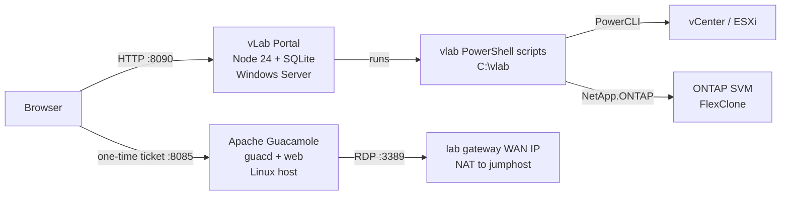

# vLab Portal (vLab 2.0)

A multi-user web portal for [madlabber/vlab](https://github.com/madlabber/vlab).

vlab provisions instant lab copies on VMware vSphere and NetApp ONTAP: one FlexClone volume, a fresh set of VLANs and a new vApp per copy. vLab Portal keeps vlab's PowerShell scripts as the engine and replaces the web front end. It adds user accounts, per-user lab access, quotas, a job log, an audit trail, and remote desktop in the browser through Apache Guacamole.

It installs **on top of an existing vlab (brownfield)** without changing it, or **from scratch (greenfield)**, in which case it fetches vlab for you.

---

## Contents
1. [What's new compared to vlab 1.x](#whats-new-compared-to-vlab-1x)
2. [How it works](#how-it-works)
3. [Requirements](#requirements)
4. [Pick your path: brownfield or greenfield](#pick-your-path-brownfield-or-greenfield)
5. [Step 1 – Remote desktop host (Guacamole)](#step-1--remote-desktop-host-guacamole)
6. [Step 2a – Install: brownfield (existing vlab)](#step-2a--install-brownfield-existing-vlab)
7. [Step 2b – Install: greenfield (new site)](#step-2b--install-greenfield-new-site)
8. [Step 3 – First sign-in and adding users](#step-3--first-sign-in-and-adding-users)
9. [Using the portal](#using-the-portal)
10. [Lab templates: what vlab expects](#lab-templates-what-vlab-expects)
11. [Retiring the legacy portal (brownfield)](#retiring-the-legacy-portal-brownfield)
12. [Configuration reference](#configuration-reference)
13. [Update, backup, uninstall](#update-backup-uninstall)
14. [Security notes](#security-notes)
15. [Troubleshooting](#troubleshooting)
16. [Known limitations](#known-limitations)
17. [Credits](#credits)

---

## What's new compared to vlab 1.x

| | vlab 1.x portal | vLab Portal 2.0 |
|---|---|---|
| Sign-in | none: anyone who can reach port 8081 can provision, kill or destroy | local accounts, admin and user roles, forced password change, lockout after 5 failed attempts |
| Who sees what | everyone sees everything | admins grant catalog labs per user; users see and control only their own copies |
| Quotas | none | per-user maximum number of lab copies |
| Running scripts | URL text passed straight to `powershell.exe` (command injection) | fixed script per action, `-File` with an argument list, validated lab names |
| Long jobs | browser page waits on the script | job queue with a live log; one job per lab at a time |
| Status | each page runs PowerShell (slow) | inventory refreshed in the background every 60 s |
| Remote desktop | Myrtille on IIS; shared RDP password visible on the Admin page | Apache Guacamole with one-time encrypted tickets; the RDP password never reaches the browser |
| History | none | job history plus an audit log of every sign-in and change |
| Runtime | system-wide Node 18 (end of life), nodemon, IIS | private Node 24 LTS in `.\runtime`; no IIS |

Nothing in vlab itself changes. The portal calls the same scripts (`new-vlabclone.ps1`, `start-vlab.ps1`, `stop-vlab.ps1`, `remove-vlab.ps1`, …) and reads the same `settings.cfg`, `cmdb\descriptions.tbl`, `cmdb\<lab>.jpg|png` and `cmdb\<lab>.conf`.

## How it works



* **Catalog** = ONTAP volumes named `lab_*` that are *not* clones (lab templates).
* **Lab copies** = FlexClones of a template (`lab_<template>_<n>`), each with its own vApp and VLANs.
* The portal stores **users, grants, lab owners, jobs and the audit log** in `data\portal.db` (SQLite). Everything about the labs themselves still lives in vCenter and ONTAP.
* **Connect** sends a signed, encrypted, 5-minute ticket to Guacamole. The ticket names one user and one RDP target: the lab gateway's WAN IP on port 3389, which the gateway NATs to the lab jumphost.

## Requirements

**Portal server (Windows)**
* Windows Server 2019, 2022 or 2025, with Windows PowerShell 5.1. A domain-joined server is fine.
* A Windows account to run the portal. It must be a local administrator and must be **the same account that saved vlab's credentials** (`vicred.clixml`, `nccred.clixml`). Those files are encrypted for one Windows user and one machine only.
* Internet access during install to `nodejs.org`, `registry.npmjs.org` and `www.powershellgallery.com` (only if modules are missing). Greenfield also needs `github.com`.
* About 300 MB of disk space.

**Virtual infrastructure** (the same as vlab 1.x)
* vCenter with a cluster of ESXi hosts and a standard vSwitch present on every host.
* An ONTAP SVM exporting an NFS datastore mounted on those hosts. Lab template volumes are junctioned under it.
* vCenter and ONTAP accounts with rights to clone volumes and to create vApps, port groups and VMs.

**Remote desktop (optional, recommended)**
* Any Linux host with Podman (RHEL, Rocky or Alma 9+) or Docker (Ubuntu, Debian, …), 2 GB RAM. It can be an existing utility VM.
* Each lab's gateway must forward TCP 3389 on its WAN address to the lab jumphost. LabBuilder pfSense gateways do this with the "RDP to Jumphost" NAT rule.

**Network ports**

| From | To | Port | Why |
|---|---|---|---|
| Users' browsers | portal server | 8090/tcp | portal UI and API |
| Users' browsers | Guacamole host | 8085/tcp | remote desktop in the browser |
| Portal server | Guacamole host | 8085/tcp | (installer check only) |
| Guacamole host | lab gateway WAN IPs | 3389/tcp | RDP to lab jumphosts |
| Portal server | vCenter, ONTAP mgmt | 443/tcp | vlab scripts |

## Pick your path: brownfield or greenfield

| You have… | Path | What the installer does with vlab |
|---|---|---|
| vlab already running (`C:\vlab\settings.cfg` exists; the old portal is on :8081) | **Brownfield** | reuses it unchanged: same settings, credentials, templates and lab copies. Existing copies appear in the new portal, unassigned, for an admin to hand out |
| Nothing yet | **Greenfield** | downloads vlab (a pinned, tested commit) to `C:\vlab`, asks for your settings, installs PowerCLI and NetApp.ONTAP, saves credentials |

The installer chooses automatically: if `<VlabRoot>\settings.cfg` exists it does a brownfield install, otherwise greenfield. `VlabRoot` defaults to `C:\vlab`, and `-VlabRoot D:\vlab` points it elsewhere.

## Step 1 – Remote desktop host (Guacamole)

Do this first so the portal installer can take the Guacamole URL and key. You can also skip it and add them later (see [Configuration reference](#configuration-reference)).

On the Linux host, as a normal user (not root):

```bash
git clone <this-repo-url> vlab-portal
cd vlab-portal/guacamole
./install-guacamole.sh            # optional: a port other than 8085, e.g. ./install-guacamole.sh 9085
```

When it finishes it prints:

```
 Guacamole URL : http://10.0.0.5:8085/guacamole
 JSON key      : 3f9c…(32 hex characters)
```

Write both down. If the script says so, also run its two `sudo` lines:

```bash
sudo firewall-cmd --permanent --add-port=8085/tcp && sudo firewall-cmd --reload   # open the port
sudo loginctl enable-linger $USER                                                # keep running after logout / at boot (Podman)
```

The script runs Guacamole 1.6.0 with only the encrypted-JSON login enabled. There is no Guacamole user database or default `guacadmin` account to secure. The key is stored in `~/guacamole/guacamole.env` (mode 600).

## Step 2a – Install: brownfield (existing vlab)

On the vlab Windows server, signed in as **the account that runs vlab today** (the one that saved the `.clixml` credentials):

1. Get the code. Install it **next to** vlab, not inside it, in a path without spaces:
   ```powershell
   git clone <this-repo-url> C:\vlab-portal
   ```
   (No git? Download the ZIP from GitHub and extract it to `C:\vlab-portal`.)
2. Open **Windows PowerShell as Administrator** and run:
   ```powershell
   cd C:\vlab-portal
   Set-ExecutionPolicy -Scope Process Bypass -Force
   .\install.ps1 -GuacamoleUrl http://<guac-host>:8085/guacamole -GuacamoleKey <32-hex-key>
   ```
   Leave out the two Guacamole parameters if you skipped Step 1.
3. The installer:
   * confirms `C:\vlab\settings.cfg` exists (brownfield)
   * checks that the saved credentials can be decrypted by your account. If they can't (another account saved them), it asks for vCenter and ONTAP credentials again and keeps a `.bak` of the old files.
   * downloads Node.js 24 LTS into `C:\vlab-portal\runtime` and verifies its checksum. The system Node 18 that the old portal uses is not touched.
   * asks for **your Windows password** once, to register the "vLab Portal" scheduled task that starts the portal at boot under your account
4. It prints the URL (`http://<server>:8090`) and where to find the first admin password.

The legacy portal on :8081 keeps running. The two can run side by side because both read the same vlab files. See [Retiring the legacy portal](#retiring-the-legacy-portal-brownfield) when you're ready.

## Step 2b – Install: greenfield (new site)

1. Prepare a Windows Server (see [Requirements](#requirements)) and sign in as the account that will run the portal.
2. Get the code:
   ```powershell
   git clone <this-repo-url> C:\vlab-portal
   ```
3. Open **Windows PowerShell as Administrator**:
   ```powershell
   cd C:\vlab-portal
   Set-ExecutionPolicy -Scope Process Bypass -Force
   .\install.ps1 -GuacamoleUrl http://<guac-host>:8085/guacamole -GuacamoleKey <32-hex-key>
   ```
4. The installer downloads vlab into `C:\vlab` and asks for these settings, which it writes to `C:\vlab\settings.cfg`:

   | Setting | Example | What it is |
   |---|---|---|
   | `sitename` | `Acme Lab Portal` | title shown in the portal |
   | `vCenter` | `vcsa.lab.local` | vCenter that runs the labs |
   | `VICluster` | `Lab-Cluster` | vSphere cluster for lab VMs |
   | `vswitch` | `vSwitch0` | **standard** vSwitch where lab port groups are created (must exist on every host in the cluster) |
   | `VIPortgroup` | `VM Network` | port group for the lab gateways' WAN side |
   | `vlanbase` | `1000` | lab VLANs are allocated upward from here; your physical switch ports must trunk this range |
   | `cluster_mgmt` | `10.0.0.30` | ONTAP cluster management address |
   | `vserver` | `svm_labs` | SVM that holds the lab volumes |
   | `VIDatastore` | `LABs` | NFS datastore from that SVM; lab volumes are junctioned at `/<VIDatastore>/lab_*` |
   | `newID` | `1000` | lab copies are numbered after this (`lab_x_1001`, …) |
   | `autostart` | `false` | start copies right after provisioning |
   | `rdpdomain` / `rdpuser` / `rdppassword` | `lab` / `administrator` / … | default login for lab jumphosts; override per template in `C:\vlab\cmdb\<template>.conf` |

   It then installs the **VCF.PowerCLI** and **NetApp.ONTAP** modules (a few minutes), asks for the **vCenter** and **ONTAP** credentials, enables PowerShell remoting on localhost (vlab's scripts need it), sets up Node.js and asks for your Windows password for the scheduled task.

   For an unattended install, put the settings in a JSON file and pass `-SettingsFile settings.json`. Use the same keys as the table above.
5. Add lab templates (see [Lab templates](#lab-templates-what-vlab-expects)). Until there is at least one `lab_*` volume, the catalog is empty.

## Step 3 – First sign-in and adding users

1. On the server, open `C:\vlab-portal\data\initial-admin-password.txt`.
2. Browse to `http://<server>:8090` and sign in as **admin** with that password. You'll be asked to choose a new one (10+ characters).
3. Delete `initial-admin-password.txt`.
4. Go to **Users → New user**:
   * **Role**: *User* (sees only their own labs) or *Admin* (sees and manages everything).
   * **Max lab copies**: how many copies this person may hold at once.
   * **Catalog labs this user can launch**: tick the templates they may copy.
5. The portal shows a **one-time password** once. Give it to the user. They must change it at first sign-in. **Reset password** issues a new one; **Disable** blocks sign-in and ends their sessions immediately.
6. Brownfield: existing lab copies show as *unassigned* under **All labs**. Use the owner drop-down to hand each one to a user.

## Using the portal

**Users**
* **Catalog → Get a copy** clones the template. The job page shows the live log, and the copy is usually ready in under a minute. Copies count against the user's limit.
* **My labs**:
  * **Start** powers on every VM in the copy.
  * **Connect** opens the jumphost desktop in a new tab. It appears once the lab is running and its gateway has an IP.
  * **Shut down** shuts down the guest OSes.
  * **Power off** is a hard stop.
  * **Destroy** deletes the copy's VMs, VLANs and FlexClone. You must type the lab name to confirm.
* **Activity** shows your jobs and their logs.

**Admins**, in addition:
* **All labs** shows every copy, and the owner drop-down reassigns copies.
* **Catalog → Manage…** on each template:

  | Menu item | What it runs |
  |---|---|
  | Edit description | writes `cmdb\descriptions.tbl` (the legacy portal reads the same file) |
  | Snapshot | renames the old `master` snapshot and takes a new one; future copies start from it |
  | Enable (import) | registers the template VMs as a vApp |
  | Disable | removes the template vApp; the volume and its snapshots are kept |
  | Mount for authoring / Unmount authoring | edit a template in place |
  | Start, Shut down, Power off template | power actions on the template's VMs |
* **Refresh status** re-reads vCenter and ONTAP immediately instead of waiting up to 60 seconds.
* **Audit log** records every sign-in, failed sign-in, provision, power action, connect and user change, with the source IP.

## Lab templates: what vlab expects

A template is something vlab can clone. Any lab built with [LabBuilder](https://github.com/madlabber/LabBuilder) works. By hand, a template is:

1. An ONTAP volume named `lab_<name>` on the `vserver` SVM, junctioned at `/<VIDatastore>/lab_<name>`.
2. The lab's VM folders inside that volume.
3. A vApp named `lab_<name>` containing those VMs. **Enable (import)** creates it from the volume.
4. Port groups named `lab_<name>_net1`, `_net2`, … for the lab's internal networks.
5. A VM whose name contains `gateway`. Its first IP address is treated as the lab's WAN address, used for **Connect**.
6. Optional: a `master` snapshot. **Snapshot** creates it, and copies are cloned from it; without one, vlab snapshots the volume at provision time.
7. Optional: `C:\vlab\cmdb\lab_<name>.jpg` (or `.png`) for the catalog picture, `descriptions.tbl` text, and `lab_<name>.conf` with `rdpdomain=`, `rdpuser=` and `rdppassword=` to override the jumphost login.

## Retiring the legacy portal (brownfield)

Once everyone uses the new portal:

1. Stop the old Node.js portal (port 8081). If it runs in a console window, close the window. Check that nothing still listens:
   ```powershell
   Get-NetTCPConnection -LocalPort 8081 -State Listen -ErrorAction SilentlyContinue
   ```
2. Remove whatever starts it at boot, if you set one up: a shortcut in the Startup folder, a scheduled task or a service.
3. Optional: uninstall **Myrtille** (Apps & Features) and the IIS role if nothing else uses them. The new portal needs neither.
4. Keep `C:\vlab`. The new portal runs vlab's scripts from there.

## Configuration reference

`C:\vlab-portal\config.json` (written by the installer; only the installing account, SYSTEM and Administrators can read it):

| Key | Default | Meaning |
|---|---|---|
| `port` | `8090` | HTTP port. If you change it, add a firewall rule for the new port and restart the task |
| `vlabRoot` | `C:\vlab` | where vlab's scripts and `settings.cfg` live |
| `inventoryIntervalSec` | `60` | how often lab status is re-read from vCenter and ONTAP |
| `maxConcurrentJobs` | `2` | jobs (provision, start, …) that may run at the same time; each lab runs at most one |
| `secureCookies` | `false` | set to `true` when users reach the portal through HTTPS (reverse proxy) |
| `guacamole.url` | – | e.g. `http://10.0.0.5:8085/guacamole`; empty turns **Connect** off |
| `guacamole.jsonSecretKey` | – | the 32-hex `JSON_SECRET_KEY` from the Guacamole host |

After editing, restart: `Restart-ScheduledTask` isn't available on Windows PowerShell 5.1, so use
```powershell
Stop-ScheduledTask 'vLab Portal'; Start-ScheduledTask 'vLab Portal'
```

To add Guacamole later you can re-run `.\install.ps1 -GuacamoleUrl … -GuacamoleKey …`. It keeps your config and users and only updates those two values.

## Update, backup, uninstall

* **Update**: `cd C:\vlab-portal; .\update.ps1` (elevated). It runs `git pull`, backs up `data\portal.db`, runs `npm ci` and restarts the task.
* **Backup**: copy `C:\vlab-portal\data\portal.db` and `config.json`. Everything else is either in vlab, vCenter or ONTAP, or can be reinstalled.
* **Move to a new server**: install there, then copy `data\portal.db` across before the first start.
* **Uninstall**: `.\uninstall.ps1` removes the scheduled task and firewall rule and keeps `data`. Add `-RemoveData` to delete users and history. vlab, vCenter, ONTAP and every lab are left untouched.

## Security notes

* Passwords are stored as scrypt hashes. Sessions are random 256-bit tokens, stored only as hashes and valid for 12 hours. After 5 failed sign-ins a username is locked for 15 minutes from that IP.
* Every state-changing request must come from the portal's own page: a custom header, `SameSite=Strict` cookies and a strict Content-Security-Policy. Lab names are validated, and each action maps to one fixed vlab script, run with `-File` and an argument list.
* The portal serves **HTTP**. Anywhere beyond a trusted lab network, put it behind a TLS reverse proxy (IIS ARR, nginx, Caddy, …) and set `secureCookies: true`. Do the same for Guacamole.
* `settings.cfg` stores the default jumphost RDP password in plain text, as vlab 1.x does. The portal reads it server-side and puts it only inside the encrypted Guacamole ticket.
* The Guacamole JSON key works like a master key for remote desktops. Keep `config.json` and `~/guacamole/guacamole.env` private, and generate a new key (delete the env file and re-run the Guacamole installer) if it leaks.

## Troubleshooting

| Symptom | Cause / fix |
|---|---|
| Scheduled task shows *Ready*, last result `0x1`, and nothing listens on 8090 | the task's command line is broken; re-run `.\install.ps1`. Also check that the portal path has no spaces |
| Task is *Running* but the page doesn't load from another PC | Windows Firewall: `Get-NetFirewallRule -Name vLabPortal-*` should exist and be enabled |
| Banner "Reading lab status…" stays more than a few minutes, or an admin sees an inventory error | read `logs\portal.log`. Usually vCenter or ONTAP is unreachable, or the credentials expired: run `C:\vlab\set-vlabcreds.ps1` **as the portal's account**, then restart the task |
| Start, Stop or Provision fail with `Connecting to remote server localhost failed … Access is denied` | vlab's scripts open a PowerShell session to localhost. Run `Enable-PSRemoting -Force`, and make sure the task runs with a stored password (the installer does this), not "S4U / do not store password" |
| Credentials can't be decrypted ("Key not valid for use in specified state") | `.clixml` files were saved by another Windows account. Re-run `install.ps1` as the portal account; it asks for them again |
| A job shows *succeeded* but the lab looks incomplete | vlab 1.x scripts often exit 0 after an error. Read the job log; the real error is usually a line or two above the end |
| **Connect** is greyed out | the lab isn't running, the gateway has no IP yet (wait for VMware Tools), or Guacamole isn't configured (`guacamole.url` empty) |
| Connect opens a tab that says the connection failed | from the Guacamole host, `nc -vz <gateway-wan-ip> 3389` must succeed. Check the gateway's NAT rule and the jumphost's RDP login in `settings.cfg` / `cmdb\<template>.conf` |
| A new copy is on the wrong network, or VLANs clash | an older copy with the same name left port groups behind (vlab removes only port groups that VMs are attached to). Delete stale `lab_<copy>_net*` port groups on **every** host, including hosts outside the cluster |
| Forgot the admin password | another admin can reset it. If there is no other admin: stop the task, delete `data\portal.db` (users, grants and history are lost; labs are not), start the task, and use the new `initial-admin-password.txt` |

Logs: `C:\vlab-portal\logs\portal.log` (server), each job's log on its **Activity** page, `podman logs guacamole-web` / `podman logs guacd` on the Guacamole host.

## Known limitations

* One portal server and one vCenter/ONTAP pair per install, as in vlab 1.x.
* Lab copy names are reused once a copy is destroyed (`lab_x_1001` again), so clean stale port groups as described above.
* Status lags real changes by up to `inventoryIntervalSec`. Use **Refresh status** as an admin.
* vlab's own limitations still apply (standard vSwitches, NFS datastores, a single SVM).

## Credits

* **vlab**, the provisioning engine this portal drives, is by Sean ([madlabber](https://github.com/madlabber)). vLab Portal does not include vlab's code; greenfield installs download it from GitHub at a pinned commit.
* Remote desktop by [Apache Guacamole](https://guacamole.apache.org/).
