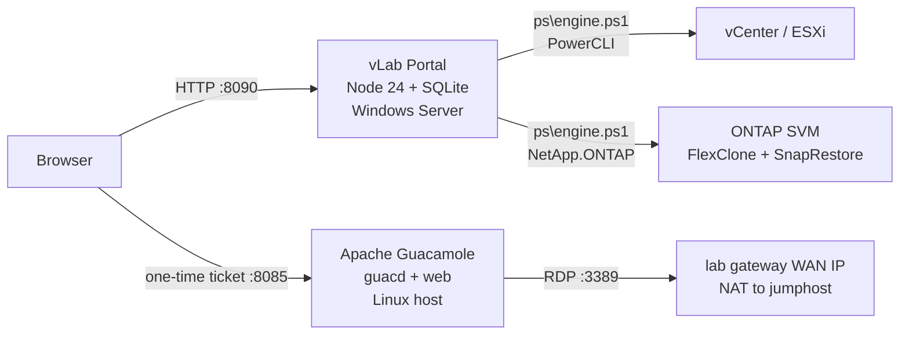

# vLab Portal (vLab 2.0)

A self-contained, multi-user portal for **instant lab copies on VMware vSphere and NetApp ONTAP**.

An admin keeps a catalog of lab templates. Users get their own copy of a template in seconds: a FlexClone volume, a fresh set of VLANs and a new vApp. They can start, stop, snapshot, restore and remove that copy, and open its desktop in the browser.

vLab 2.0 is the successor to [madlabber/vlab](https://github.com/madlabber/vlab) (vlab 1.x). It **does not need vlab 1.x**: it has its own engine, settings and credentials.
* **Brownfield** (vlab 1.x already installed): the installer imports vlab 1.x's settings, saved credentials, descriptions and diagrams once. Existing templates and lab copies appear automatically, and vlab 1.x is left untouched.
* **Greenfield** (new site): the installer asks for vCenter and ONTAP settings and credentials, the same way vlab 1.x's installer did.

---

## Contents
1. [What you get](#what-you-get)
2. [How it works](#how-it-works)
3. [Requirements](#requirements)
4. [Step 1 – Remote desktop host (Guacamole)](#step-1--remote-desktop-host-guacamole)
5. [Step 2 – Install the portal](#step-2--install-the-portal)
   * [Brownfield (vlab 1.x installed)](#brownfield-vlab-1x-installed)
   * [Greenfield (new site)](#greenfield-new-site)
6. [Step 3 – First sign-in and adding users](#step-3--first-sign-in-and-adding-users)
7. [Using the portal](#using-the-portal)
8. [Lab snapshots and restore](#lab-snapshots-and-restore)
9. [Lab templates](#lab-templates)
10. [Retiring vlab 1.x (brownfield)](#retiring-vlab-1x-brownfield)
11. [Configuration reference](#configuration-reference)
12. [Update, backup, uninstall](#update-backup-uninstall)
13. [Security notes](#security-notes)
14. [Troubleshooting](#troubleshooting)
15. [Known limitations](#known-limitations)
16. [Credits](#credits)

---

## What you get

| | vlab 1.x | vLab Portal 2.0 |
|---|---|---|
| Sign-in | none: anyone who can reach the portal can provision or destroy | local accounts, admin and user roles, forced password change, lockout after 5 failed attempts |
| Who sees what | everyone sees everything | admins grant catalog labs per user; users see and control only their own copies |
| Quotas | none | per-user maximum number of lab copies |
| **Snapshots** | none for users | **users can snapshot their copy, restore to any snapshot, or reset it to exactly how it was deployed** |
| Engine | PowerShell scripts called with URL text (command injection) | own engine: one fixed action per request, validated names, `-File` with arguments |
| Long jobs | browser waits on the script | job queue with a live log; one job per lab at a time |
| Status | each page runs PowerShell | inventory refreshed in the background every 60 s |
| Remote desktop | Myrtille on IIS; shared password shown on the Admin page | Apache Guacamole with one-time encrypted tickets; the RDP password never reaches the browser |
| History | none | job history plus an audit log of every sign-in and change |
| Clean-up | port groups of destroyed labs are left behind, and VLANs can collide | destroy removes port groups on every host; provisioning removes stale ones and picks VLANs that are free on every host |
| Runtime | system Node 18 (end of life), nodemon, IIS, WinRM | private Node 24 LTS in `.\runtime`; no IIS, no WinRM |

## How it works



* **Catalog**: ONTAP volumes named `lab_*` that are *not* clones (lab templates).
* **Lab copy**: a FlexClone of a template named `lab_<template>_<n>`, with its own vApp and VLAN-backed port groups.
* **Engine**: `ps\engine.ps1` (provision, start, stop, power off, destroy, snapshots, template actions) and `ps\inventory.ps1` (read-only status). It uses the VCF.PowerCLI and NetApp.ONTAP PowerShell modules.
* **Portal data**: users, grants, lab owners, jobs and the audit log are in `data\portal.db` (SQLite). Everything about the labs themselves lives in vCenter and ONTAP.
* **Connect**: sends Guacamole a signed, encrypted, 5-minute ticket for one user and one RDP target, the lab gateway's WAN IP on port 3389.

## Requirements

**Portal server (Windows)**
* Windows Server 2019, 2022 or 2025, with Windows PowerShell 5.1. A domain-joined server is fine.
* A Windows account that is a local administrator. The portal runs as this account, and its saved credentials are encrypted for this account only.
* Internet access during install to `nodejs.org`, `registry.npmjs.org` and `www.powershellgallery.com` (the last only if the modules aren't installed).
* About 300 MB of disk space and 1 GB RAM.

**vSphere**
* vCenter with a cluster of ESXi hosts and a **standard vSwitch** present on every host in it.
* A port group for lab gateways' WAN side (for example `VM Network`).
* A vCenter account allowed to create vApps, port groups and DRS rules, and to register, reconfigure, power and unregister VMs.

**ONTAP**
* An SVM exporting an **NFS datastore** that is mounted on those hosts. Lab volumes are junctioned under it as `/<datastore>/lab_*`.
* **FlexClone** and **SnapRestore** licences (both are part of ONTAP One). SnapRestore is used for lab restore.
* An ONTAP account allowed to create, clone, mount, snapshot, restore and delete volumes on that SVM.

**Remote desktop (optional, recommended)**
* Any Linux host with Podman (RHEL, Rocky or Alma 9+) or Docker (Ubuntu, Debian, …), 2 GB RAM.
* Each lab gateway forwards TCP 3389 on its WAN IP to the lab jumphost. LabBuilder pfSense gateways do this with the "RDP to Jumphost" NAT rule.

**Network ports**

| From | To | Port | Why |
|---|---|---|---|
| Users' browsers | portal server | 8090/tcp | portal |
| Users' browsers | Guacamole host | 8085/tcp | remote desktop |
| Portal server | vCenter, ONTAP management | 443/tcp | engine |
| Guacamole host | lab gateway WAN IPs | 3389/tcp | RDP to jumphosts |

## Step 1 – Remote desktop host (Guacamole)

Optional, but do it first so the portal installer can take the URL and key. You can also add them later by re-running the installer.

On the Linux host, as a normal user:

```bash
git clone https://github.com/humbledgeeks/vlab-portal.git vlab-portal
cd vlab-portal/guacamole
./install-guacamole.sh            # optional: a port other than 8085, e.g. ./install-guacamole.sh 9085
```

When it finishes it prints:

```
 Guacamole URL : http://10.0.0.5:8085/guacamole
 JSON key      : 3f9c…(32 hex characters)
```

If the script asks for them, also run its two `sudo` lines:

```bash
sudo firewall-cmd --permanent --add-port=8085/tcp && sudo firewall-cmd --reload   # open the port
sudo loginctl enable-linger $USER                                                # Podman: keep running after logout and at boot
```

The script runs Guacamole 1.6.0 with **only** encrypted-JSON login, so there is no Guacamole user database and no default `guacadmin` account. The key is kept in `~/guacamole/guacamole.env` (mode 600).

## Step 2 – Install the portal

Sign in to the Windows server as the account that should run the portal, then:

```powershell
git clone https://github.com/humbledgeeks/vlab-portal.git C:\vlab-portal          # or download the ZIP and extract it to C:\vlab-portal
```

Use a path **without spaces**. Then open **Windows PowerShell as Administrator**:

```powershell
cd C:\vlab-portal
Set-ExecutionPolicy -Scope Process Bypass -Force
.\install.ps1 -GuacamoleUrl http://<guac-host>:8085/guacamole -GuacamoleKey <32-hex-key>
```

Leave out the two Guacamole parameters if you skipped Step 1.

The installer works out which case applies by itself:

| Found | Mode | What happens |
|---|---|---|
| `C:\vlab\settings.cfg` (vlab 1.x) | **brownfield** | imports settings, credentials, descriptions and diagrams |
| nothing | **greenfield** | asks for settings and credentials |
| an earlier vLab Portal `config.json` | **reinstall** | keeps settings, credentials and users; updates the runtime and task |

Options: `-LegacyVlabRoot D:\vlab` if vlab 1.x is somewhere else, `-Greenfield` to ignore an existing vlab 1.x, `-Port 8091` for a different port.

### Brownfield (vlab 1.x installed)

Run the installer **as the account that runs vlab 1.x**, so it can read vlab's saved credentials. It then:

1. Reads `C:\vlab\settings.cfg` and shows the values it imported:

   | vlab 1.x key | becomes (config.json) |
   |---|---|
   | `sitename` | `site.name` |
   | `vCenter`, `VICluster`, `vswitch`, `VIPortgroup`, `vlanbase` | `vcenter.server`, `.cluster`, `.vswitch`, `.wanPortgroup`, `.vlanBase` |
   | `cluster_mgmt`, `vserver`, `VIDatastore` | `ontap.cluster`, `.svm`, `.datastore` |
   | `newID`, `autostart` | `labs.firstId`, `labs.autostart` |
   | `rdpdomain`, `rdpuser`, `rdppassword` | `rdp.domain`, `.user`, `.password` |
2. Copies `vicred.clixml` and `nccred.clixml` into `data\`. If another Windows account saved them, it asks for the credentials instead.
3. Copies `cmdb\descriptions.tbl`, `cmdb\*.jpg|png` and `cmdb\*.conf` into `catalog\`.
4. Tests the vCenter and ONTAP connections and reports how many lab volumes it sees.
5. Installs Node.js 24, opens the firewall, and asks for your Windows password to register the boot task.

Existing lab copies appear in the portal as **unassigned**; give them to users under **All labs**. vlab 1.x is not changed and keeps working, so both can run side by side while you switch over.

### Greenfield (new site)

The installer asks for:

| Setting | Example | Meaning |
|---|---|---|
| Portal name | `Acme Lab Portal` | shown in the browser |
| vCenter server | `vcsa.lab.local` | |
| vSphere cluster | `Lab-Cluster` | where lab VMs run |
| Standard vSwitch | `vSwitch0` | lab port groups are created on it, on every host of the cluster |
| WAN port group | `VM Network` | lab gateways' outside network |
| VLAN base | `1000` | lab VLANs are allocated above this; your physical switch ports must trunk the range |
| ONTAP cluster address | `10.0.0.30` | cluster management LIF |
| SVM | `svm_labs` | holds the lab volumes |
| NFS datastore | `LABs` | lab volumes are junctioned at `/LABs/lab_*`, and that path is mounted in vSphere as this datastore |
| First copy number | `1000` | copies are named `lab_x_1001`, `lab_x_1002`, … |
| Autostart | `false` | power copies on right after provisioning |
| RDP domain, user, password | `lab`, `administrator`, … | default jumphost login for **Connect**; override per template in `catalog\<template>.conf` |

It then installs **VCF.PowerCLI** and **NetApp.ONTAP** if they're missing (a few minutes), asks for the **vCenter** and **ONTAP** credentials, tests both connections, and finishes as for brownfield.

For an unattended install, pass `-SettingsFile settings.json`, containing the keys `siteName, vcenter, cluster, vswitch, wanPortgroup, vlanBase, ontapCluster, svm, datastore, firstId, autostart, rdpDomain, rdpUser, rdpPassword`. Credentials are still prompted for, unless `data\*.cred.xml` already exist.

Next, add lab templates (see [Lab templates](#lab-templates)). The catalog stays empty until at least one `lab_*` volume exists.

## Step 3 – First sign-in and adding users

1. Open `C:\vlab-portal\data\initial-admin-password.txt`. It is created when the portal first starts.
2. Browse to `http://<server>:8090` and sign in as **admin** with that password. You'll be asked to choose a new one (10+ characters). Then delete the file.
3. Go to **Users → New user** and set:
   * **Role**: *User* (only their own labs) or *Admin* (everything).
   * **Max lab copies**: how many copies they may hold at once.
   * **Catalog labs this user can launch**: tick the templates they may copy.
4. The portal shows a **one-time password** once. Give it to the user; they must change it at first sign-in. **Reset password** issues a new one, and **Disable** blocks sign-in and ends their sessions immediately.

## Using the portal

**Users**
* **Catalog → Provision** clones the template. The job page shows the live log, and the copy is usually ready within a minute.
* **My labs**:
  * **Start** powers on the copy.
  * **Connect** opens the jumphost desktop in a new tab. It appears once the lab is running and the gateway has an IP.
  * **Shut down** shuts down the guest OSes; **Power off** is a hard stop.
  * **Snapshots** opens the lab page, where you take snapshots and restore them (see the next section).
  * **Destroy** deletes the copy's VMs, VLANs and volume. You must type the lab name to confirm.
* **Activity** shows your jobs and their logs.

**Admins**, in addition:
* **All labs**: every copy, with an owner drop-down to reassign copies.
* **Catalog → Manage…** on each template:

  | Item | What it does |
  |---|---|
  | Edit description | text on the catalog card (stored in `catalog\descriptions.tbl`) |
  | Upload / Replace diagram | PNG or JPEG (up to 10 MB) shown on the catalog card and on every copy of the template (stored as `catalog\<template>.png` or `.jpg`) |
  | New master snapshot | snapshot `master` of the template (the previous one is kept, renamed `master.<date>`); new copies start from it, existing copies are unaffected |
  | Enable (import) | mounts the template volume if needed, creates its vApp and registers its VMs |
  | Disable | removes the template vApp from vCenter; the volume, snapshots and port groups are kept |
  | Start / Shut down / Power off template | power the template's VMs on or off, e.g. to update the template itself |
* **Catalog → template name** opens the template's page: status, gateway IP, its VMs (power state, IP, guest OS, vCPU/RAM), diagram and job history. While the template is running, **Connect** (on the card and the page) opens its jumphost desktop, e.g. to update the template.
* **Settings**: rename the portal (top-left, browser tab and sign-in page). Takes effect at once; blank goes back to `site.name` from `config.json`.
* **Refresh status** re-reads vCenter and ONTAP now instead of within 60 seconds.
* **Audit log**: every sign-in, failed sign-in, provision, power action, snapshot, restore, connect and user change, with the source IP.

## Lab snapshots and restore

Every lab copy has a **Snapshots** section on its page.

* **Take snapshot**: saves the copy's whole state (all VM disks and settings) under a name you choose. It's instant, using an ONTAP snapshot of the copy's FlexClone volume.
  * A copy can hold up to **5** snapshots (`labs.maxSnapshotsPerLab`); delete one to make room.
  * Snapshots of a **running** lab are allowed but crash-consistent, like pulling the power plug, and the portal warns about this. Shut down first for a clean snapshot.
* **Restore**:
  1. Powers the copy off.
  2. Rolls its volume back with SnapRestore.
  3. Re-registers the VMs.
  4. Reconnects them to **the copy's own** networks, serial pipes and settings.

  The copy is left powered off. ONTAP deletes any snapshots taken **after** the one you restore, and the portal says so before you confirm.
* **Reset to original**: every copy has a permanent "Original (as deployed)" snapshot, the point it was cloned from. Resetting returns it to exactly how it was deployed. This works for copies made by vlab 1.x too.
* Only that one copy is touched. The template and other users' copies are never affected.

Restoring needs the **SnapRestore** licence (part of ONTAP One).

## Lab templates

A template is anything the engine can clone. Labs built with [LabBuilder](https://github.com/madlabber/LabBuilder) and vlab 1.x templates work as they are. By hand, a template is:

1. An ONTAP volume `lab_<name>` on the SVM, junctioned at `/<datastore>/lab_<name>`.
2. The lab's VM folders inside it.
3. A vApp named `lab_<name>` with those VMs. **Enable (import)** creates it.
4. Port groups `lab_<name>_net1`, `_net2`, … for the lab's internal networks. Copies get their own `lab_<name>_<n>_net1`, … on free VLANs.
5. A VM whose name contains `gateway`. Its first network card that isn't on a lab network is connected to the WAN port group, and its first IP is used for **Connect**.
6. Optional: a `master` snapshot. Copies are cloned from it; without one, the engine snapshots the template at provision time.
7. Optional: `catalog\lab_<name>.jpg` or `.png` (picture), a line in `catalog\descriptions.tbl` (text) and `catalog\lab_<name>.conf` (`rdpdomain=`, `rdpuser=`, `rdppassword=` overrides).

Templates whose internal networks are trunk (VLAN 4095) port groups get private vSwitches per copy, as in vlab 1.x.

## Retiring vlab 1.x (brownfield)

Once everyone uses the new portal:
1. Stop the vlab 1.x Node.js portal (port 8081). Close its console window or remove whatever starts it.
2. Optional: uninstall **Myrtille** and the IIS role if nothing else uses them.
3. You can keep `C:\vlab` as a fallback or archive it. vLab Portal does not use it after installation.

## Configuration reference

`C:\vlab-portal\config.json`. The installer writes it, and only the installing account, SYSTEM and Administrators can read it. See `config.example.json`.

| Key | Default | Meaning |
|---|---|---|
| `port` | `8090` | HTTP port. If you change it, add a firewall rule and restart |
| `inventoryIntervalSec` | `60` | how often status is re-read from vCenter and ONTAP |
| `maxConcurrentJobs` | `2` | jobs that may run at the same time; each lab runs one at a time |
| `secureCookies` | `false` | `true` when users reach the portal through HTTPS (reverse proxy) |
| `site.name` | `vLab Portal` | portal name in the browser; admins can override it under **Settings** without a restart |
| `vcenter.server`, `.cluster`, `.vswitch`, `.wanPortgroup`, `.vlanBase` | | see the greenfield table |
| `ontap.cluster`, `.svm`, `.datastore` | | see the greenfield table |
| `ontap.junctionRoot` | `/<datastore>` | set only if lab volumes are junctioned somewhere else |
| `labs.firstId`, `.autostart` | `1000`, `false` | copy numbering; power on after provisioning |
| `labs.maxSnapshotsPerLab` | `5` | user snapshots per copy (the original is extra) |
| `rdp.domain`, `.user`, `.password` | | default jumphost login for Connect |
| `guacamole.url`, `.jsonSecretKey` | | empty turns **Connect** off |

Credentials are kept in `data\vcenter.cred.xml` and `data\ontap.cred.xml` (PowerShell `Export-Clixml`, encrypted for the portal account). To change one, delete the file and re-run `.\install.ps1`.

After editing `config.json`, restart the portal:
```powershell
Stop-ScheduledTask 'vLab Portal'; Start-ScheduledTask 'vLab Portal'
```

## Update, backup, uninstall

* **Update**: `cd C:\vlab-portal; .\update.ps1` (elevated). It runs `git pull`, backs up `data\portal.db`, runs `npm ci` and restarts the portal.
* **Backup**: copy `data\` (database and credentials), `catalog\` and `config.json`.
* **Move to a new server**: install there, stop the task, copy `data\portal.db` and `catalog\` across, start the task. Credentials must be re-entered on the new server, since they are encrypted per machine and account.
* **Uninstall**: `.\uninstall.ps1` removes the boot task and firewall rule and keeps `data\`. Add `-RemoveData` to delete users and history. Labs, vCenter and ONTAP are untouched.

## Security notes

* **Accounts and sessions**: passwords are stored as scrypt hashes. Sessions are random 256-bit tokens stored only as hashes, valid for 12 hours. After 5 failed sign-ins a username is locked for 15 minutes from that IP.
* **Requests**: state-changing requests must carry the portal's own header, cookies are `SameSite=Strict`, and a strict Content-Security-Policy applies.
* **Engine**: every action maps to one engine action with validated lab and snapshot names. Destroy and snapshot actions refuse anything that isn't a FlexClone copy, so templates can't be destroyed or rolled back by a user.
* **HTTP only**: the portal serves plain HTTP. Beyond a trusted lab network, put it behind a TLS reverse proxy and set `secureCookies: true`. Do the same for Guacamole.
* **Stored secrets**: the default jumphost RDP password is stored in `config.json`, which is ACL-protected. The Guacamole JSON key works like a master key for lab desktops, so keep `config.json` and `~/guacamole/guacamole.env` private.

## Troubleshooting

| Symptom | Cause / fix |
|---|---|
| Task *Ready* with last result `0x1`; nothing on port 8090 | broken task command line. Re-run `.\install.ps1`. Also check the folder path has no spaces |
| Page doesn't load from another PC | Windows Firewall: `Get-NetFirewallRule -Name vLabPortal-*` |
| "Reading lab status…" for several minutes, or an admin sees an inventory error | read `logs\portal.log`. Usually vCenter or ONTAP is unreachable or the credentials changed: delete `data\*.cred.xml` and re-run `.\install.ps1` **as the portal account** |
| "Key not valid for use in specified state" | the credential files were saved by another Windows account or on another machine; same fix as above |
| Installer stops at the credentials step, or says "must be trusted for delegation" | you're connected over SSH with a key (or another logon without a password), and Windows can't decrypt saved credentials without one. Run `install.ps1` from an RDP or console session. The installed portal is unaffected, since its boot task stores the password |
| Provision fails with "Template … is not enabled" | the template has no vApp; use **Manage… → Enable (import)** |
| Provision fails with "Port group … already exists … with VMs attached" | a VM somewhere still uses a port group with the new copy's name; find it in vCenter and move or remove it |
| Restore fails "Snapshot … not found" | it was already removed, either deleted or by restoring an older snapshot. Refresh the page |
| A copy's VMs show up outside their vApp in vCenter | run a restore or a provision; the engine moves them back. Destroy also finds them by their folder |
| **Connect** is greyed out | the lab isn't running, its gateway has no IP yet (wait for VMware Tools), or Guacamole isn't configured |
| Connect opens but can't reach the desktop | from the Guacamole host, `nc -vz <gateway-wan-ip> 3389` must work. Check the gateway's NAT rule and the RDP login (`rdp.*` in config.json, `catalog\<template>.conf`) |
| Forgot the admin password | another admin can reset it. Otherwise: stop the task, delete `data\portal.db` (users and history are lost; labs and credentials are not), start the task, and use the new `initial-admin-password.txt` |

Logs: `logs\portal.log` (server), each job's log on **Activity**, and `podman logs guacamole-web` / `podman logs guacd` on the Guacamole host.

## Known limitations

* One vCenter cluster and one ONTAP SVM per installation.
* Standard vSwitches only (no distributed switches) and NFS datastores.
* Status can lag reality by up to `inventoryIntervalSec`. Admins can use **Refresh status**.
* Copy names are reused after a copy is destroyed (`lab_x_1001` again). The engine removes stale port groups with that name first.
* The trunked-port-group (private vSwitch) path is ported from vlab 1.x but has not been tested on a live system yet.
* vlab 1.x's "authoring mode" (mount and unmount) is replaced by starting the template itself: edit it, then take a **New master snapshot**.

## Credits

* vLab Portal builds on the design of **vlab** by Sean ([madlabber](https://github.com/madlabber)): FlexClone lab copies, the `lab_*` naming and the catalog files. It contains no vlab code, and the engine is a new implementation.
* Remote desktop by [Apache Guacamole](https://guacamole.apache.org/).
